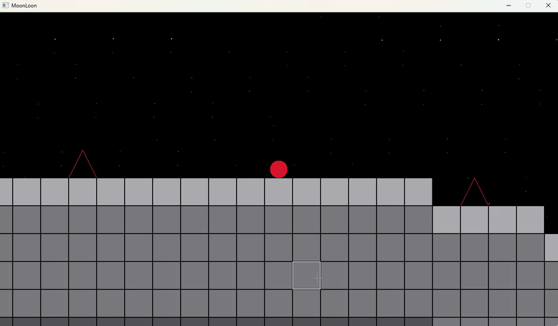

# MoonLoon

A standalone 2D sandbox platformer and software rendering engine implemented in pure C++ directly on top of the native Windows API (`windows.h`), built with **zero external libraries and no C++ Standard Library headers** (`<cmath>`, `<vector>`, `<iostream>`).



---

## Architectural Highlights

- **Zero-Dependency Core:** Implemented without runtime frameworks, DirectX/OpenGL, or CRT containers. Everything from mathematical routines to memory containers is built from scratch.
- **Custom Numerics & Math Pipeline (`CustomMath`):**
  - Polynomial Taylor series approximations for trigonometric evaluations (`Sin`, `Cos`).
  - Iterative Newton-Raphson approximation for `Sqrt`.
  - IEEE-754 bit-shifting exponentiation (`Ldexp`, `Exp`) utilizing 64-bit mantissa/exponent extraction.
- **Procedural World Generation & Coherent Noise:**
  - 2D Perlin gradient noise implementation with custom hash permutation logic (`PerlinGeneration`).
  - Chunked spatial grid partitioning ($16 \times 8$ chunks, $16 \times 16$ tiles per chunk) enabling bit-shift coordinate indexing (`>> CHUNK_SHIFT`).
- **Software Rasterizer & Double Buffering:**
  - Direct 32-bpp BGRA pixel buffer blitted to the screen via `StretchDIBits`.
  - Bresenham's line algorithm for primitive wireframe rendering of procedural hazard triangles.
  - Parallax celestial starfield with bitwise hashing.
- **Kinematic Physics & Continuous Collision:**
  - Discrete circle-to-AABB collision resolution with surface normal reconstruction.
  - Sub-pixel velocity integration, jump dampening, and hazard respawn boundaries.
- **Custom Dynamic Array Container (`myvector<T>`):**
  - Header-only heap-allocated dynamic array managing geometric resizing, copies, and element lifetimes without `std::vector`.

---

## Controls

| Key / Input  | Action                                     |
| :----------- | :----------------------------------------- |
| `A` / `D`    | Move Left / Move Right                     |
| `Space`      | Jump (Variable jump height on key release) |
| `Left Click` | Hover & Target Tile Coordinates            |
| `Alt + F4`   | Exit                                       |

---

## Building from Source

### Requirements

- Windows 10 / 11
- MSVC (Visual Studio 2022 / Build Tools) or Clang/LLVM for Windows

### Command Line (MSVC)

Open the **x64 Native Tools Command Prompt for VS**:

```cmd
git clone [https://github.com/](https://github.com/)<your-username>/MoonLoon.git
cd MoonLoon
cl.exe /O2 /W4 /EHsc /MT *.cpp user32.lib gdi32.lib /Fe:MoonLoon.exe
MoonLoon.exe
```
